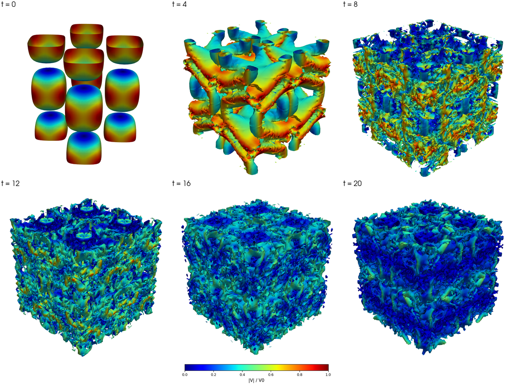
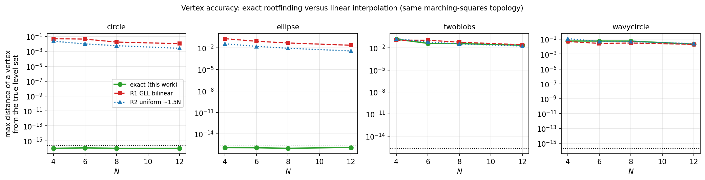
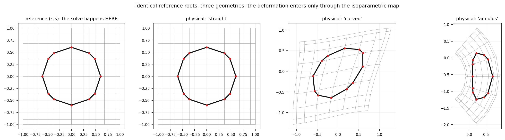
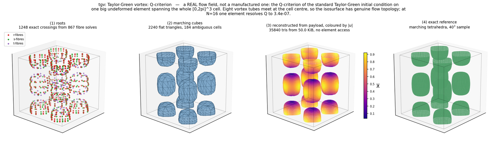

# isoSurface

A header-only NekRS (v26) plugin that extracts the isosurface `scalar = c` from a
spectral-element field, interpolates other fields onto it, and writes it as a
`.vtu`.



*Q-criterion of a Taylor–Green vortex, coloured by velocity magnitude, written
straight out of the solver by `tgv/`.*

It does **not** resample onto a fine subgrid and run marching cubes on that. The
field is already a polynomial on each element, so the plugin finds the crossings
of that polynomial exactly:

1. **Rootfinding.** All roots of a degree-$N$ polynomial in $[-1,1]$, by
   Ehrlich–Aberth on its Legendre coefficients — a simultaneous iteration on all
   $N$ roots at once, cubically convergent, with no matrix and no branches.
2. **$3(N+1)^2$ fibres.** Per element, solve `scalar = c` along every GLL line in
   the three coordinate directions. That is $3(N+1)^2$ one-dimensional problems
   per element, and it locates every intersection of the isosurface with the GLL
   lattice.
3. **Marching cubes** on that lattice. The crossings are already the cell
   corners, so nothing is interpolated along an edge.
4. **Optional 2nd-order cells.** Add mid-side nodes and Newton-project them onto
   the level set: `VTK_QUADRATIC_TRIANGLE`.
5. **Interpolate** the requested fields onto every node and write the `.vtu`.

Steps 1–4 run on the GPU. Because the vertices come from rootfinding rather than
subgrid sampling, they sit on the level set to machine precision:



*Green is this scheme; red and blue are the same marching-squares topology with
the crossing interpolated instead. Panels 3–4 are honest: where the field is
under-resolved the discretisation dominates and exactness buys nothing.*

## Files

```
isoSurface.hpp     the host side -- include it unguarded
isoSurface.okl     the kernels   -- include it inside __okl__
tgv/               worked example: Taylor-Green + Q-criterion, process()
box3d/             worked example: five analytic cases with known answers,
                   and the writeRoots()/writeSurface() debug verbs
doc/               main.pdf -- the method, the measurements, the decisions
py_demo/           the Python demos the method was designed with
DEVELOPER.md       data structures, API, kernels -- to modify the plugin
```

## Usage

Copy the two files next to your case and include them in the `.udf`.

```cpp
#ifdef __okl__
#include "isoSurface.okl"
#endif
#include "isoSurface.hpp"

static deviceMemory<dfloat> o_Q;                 // the target scalar
static std::unique_ptr<isoSurface> iso;

void UDF_Setup()
{
  o_Q.resize(nrs->meshV->Nlocal);

  IsoSurfaceParams prm;
  prm.levels    = {0.1, 0.01};   // several levels share ONE solve pass
  prm.fileName  = "isoQ";        // -> isoQ_fld_<LL>_<SSSSS>.vtu (+ .vtm)
  prm.cellOrder = 2;             // 1 = flat triangles, 2 = curved (Tri6)
  prm.niterProj = 8;             // 3 for a smooth surface, 8-32 if it folds

  iso = std::make_unique<isoSurface>(nrs->meshV,
                                     isoSurface::field{"Q", {o_Q}}, prm);
  iso->setOutputFields(
      {{"velocity", {nrs->fluid->o_solution("x"),
                     nrs->fluid->o_solution("y"),
                     nrs->fluid->o_solution("z")}},
       {"pressure", {nrs->fluid->o_solution("pressure")}}});
}

void UDF_ExecuteStep(double time, int tstep)
{
  if (nrs->checkpointStep) {
    nrs->Qcriterion(o_Q);
    iso->process(time, tstep, true);   // true = the surface moved, re-solve it
  }
  if (nrs->lastStep) iso.reset();      // free before MPI_Finalize
}
```

**The scalar is held by handle, not copied.** `o_Q` is registered once; the
plugin re-reads it at the top of every solve, so overwriting it in place needs no
re-registration. What the plugin *cannot* see is that the values changed — the
`true` is how you say so.

**The output depends on which verb you call.** There are no dump flags:

| call | writes |
|---|---|
| `process(time, tstep[, solveGeom])` | the surface with the interpolated fields |
| `writeSurface(time, tstep)` | debug: the surface alone |
| `writeRoots(time, tstep)` | debug: the raw crossings, as a point cloud |

**Several levels in one dump.** When `prm.levels` has more than one entry, rank 0 also writes
one `.vtm` multiblock file per product and dump (`<fileName>_fld_<SSSSS>.vtm`, likewise
`_srf_`/`_roots_`). Block `i` is level `i`, named `level_<LL> <field>=<value>`, and points at
that level's `.vtu`. Open the `.vtm` in ParaView to get all levels of the dump as one grouped
object; the `.vtu` files are unchanged and still open on their own. A single level writes no
`.vtm`. In Python, `iso_read.read_vtm(path)` returns `(index, name, vtu_path)` per block.

## Options (`IsoSurfaceParams`)

| field | default | meaning |
|---|---|---|
| `levels` | — | the isolevels; all share one solve pass, one file each |
| `fileName` | `"iso"` | output stem: `<fileName>_<kind>_<LL>_<SSSSS>.vtu` |
| `cellOrder` | `1` | 1 = `VTK_TRIANGLE`, 2 = `VTK_QUADRATIC_TRIANGLE` |
| `ifSolveGeom` | `false` | default for the 2-arg `process()`; the 3-arg form overrides it per call |
| `niter` | `12` | **Aberth** iterations, per fibre — the rootfinding |
| `niterProj` | `3` | **Newton** steps per P2 mid-side node — the projection |
| `aFloor` | `1e-12` | degree-deflation threshold (below) |
| `cullTheta` | `1.0` | safety factor on the element cull; 1 is rigorous |
| `capScale` | `1.0` | headroom on the per-element capacities |
| `fieldsFloat64` | `false` | write sampled fields as f64 instead of f32 |

`cellOrder = 2` is usually worth it: the mid-side nodes are projected onto the
level set, cutting the error *inside* each triangle by about 25× for ~2.5 extra
points per corner. Nodes on a shared element face are projected within that face,
so the two elements agree and the surface does not crack.

### `aFloor` and degree deflation

Each fibre's nodal values are transformed to a Legendre series $\sum_k a_k P_k$,
and the roots are found from those coefficients. A **well-resolved** fibre has a
tiny top coefficient $a_N$ — and dividing by it is exactly what makes the
classical companion-matrix construction fall over. Deflation avoids the division:
drop trailing coefficients with $|a_k| < \texttt{aFloor}\cdot\max_k|a_k|$ and
solve the lower-degree polynomial that remains.

The threshold is **relative**, so it is scale-free. Raising it truncates real
structure; lowering it lets round-off noise be treated as a genuine mode. `1e-12`
leaves both failure modes far away, and the fixed 12 Aberth iterations then
converge on whatever degree survives.

### `niter` versus `niterProj`

Easy to confuse, unrelated. `niter` is the Aberth count on a **fibre** — 12 is
machine precision and the iteration then stalls, so more costs flops and never
accuracy. `niterProj` is Newton steps per **mid-side node**, and 3 is right only
while the surface is smooth across one sub-cell; a folded field needs more, and
the run tells you (below).

## What the run prints

```
isoSurface(Q): [GPU] 181248 roots, 1024/1024 element-levels solved (0.0% culled)
isoSurface(Q): roots/element over 3584 crossed: min 7, avg 65.3, max 118  (cap 1344, peak 9%)
isoSurface(Q): projection niterProj=8, residual |f|/max|f| over 2910128 node(s): worst 1e-7
```

- **occupancy** — how close the worst element came to its capacity. Averaged over
  elements that actually cross; a `[!] near capacity` at 80% is a warning.
- **projection residual** — a histogram of how far each mid-side node ended from
  the level set. A worst decade of `1e-4` or larger prints an explicit
  recommendation to raise `niterProj`.
- **`N edge(s) carrying two crossings`** — a fibre with two roots in one lattice
  interval. Both are kept and connected; this is a measure of how folded the
  field is against the mesh, not of lost data.
- **an abort** — a capacity was exceeded. The capacities are bounds derived from
  the algorithm, so this means a bug; the message names the stage.

## Cost and limits

- Roots, marching, projection and interpolation run on the device. Physical
  coordinates, normals and the P2 node deduplication run on the host.
- Watertightness *across element faces* is not yet guaranteed. Within an element
  it is (see the face lock in `DEVELOPER.md`).
- No performance measurements yet. Point-slab occupancy is 6–29%, so transfers
  are expected to dominate before the arithmetic does.

## Why the solve happens in the reference element



Every solve is done on $[-1,1]^3$, where the field is a tensor-product
polynomial and the rootfinding is exact. The element's shape enters only through
the isoparametric map applied afterwards — so a curved or stretched element costs
nothing in accuracy.



*Left to right: the fibre roots, the marching-cubes triangulation, the surface
reconstructed from the stored payload alone, and the analytic reference.*
